# Modern NVIDIA Graphics in macOS (Turing, Ampere, Ada Lovelace, Blackwell)

## NVIDIA RTX Support is here! Sorta…

Historically, modern NVIDIA GPUs (GeForce GTX 16-series, RTX 20/30/40/50 series) were considered completely unsupported on macOS due to the lack of official drivers from Apple and NVIDIA. We've all seen this classic meme on Dortania's GPU Buyer's Guide about NVIDIA Webdrivers:


For **nearly a decade**, that meme was the definitive answer. While Apple and NVIDIA never made peace, the community stopped waiting and took matters into its own hands—turning that hard **"No"** into an emphatic **"Yes, but..."**

Enter the **NullMoth NVIDIA Driver** project: an open-source, community-developed driver stack that brings hardware acceleration and **Metal 3** support to modern NVIDIA cards on **macOS 15 (Sequoia)** and **macOS 26 (Tahoe)**.

---

## 🏗️ Architecture: How It Works

Unlike legacy NVIDIA Web Drivers, the NullMoth driver stack does not rely on Apple’s deprecated OpenGL or legacy display stacks. Instead, it implements a modern translation-layer architecture:

```mermaid
flowchart LR
    subgraph UserSpace ["User Space (macOS)"]
        App["macOS Applications & WindowServer"]
        Metal["Apple Metal 3 Framework"]
        Translator["Shader Translator (AIR ➔ SPIR-V Engine)"]
        NVMTL["NVMTLDriver (Mesa NVK-based Metal Driver)"]
    end

    subgraph KernelSpace ["Kernel Space (Darwin)"]
        Kext["macOS Kernel Driver (open-gpu-kernel-modules)"]
    end

    subgraph HardwareLevel ["Hardware & Firmware"]
        GSP["NVIDIA GSP Firmware (On-Chip RISC-V Core)"]
        GPU["NVIDIA GPU Hardware (Turing · Ampere · Ada · Blackwell)"]
    end

    App --> Metal
    Metal --> Translator
    Translator --> NVMTL
    NVMTL --> Kext
    Kext --> GSP
    GSP --> GPU

    classDef user fill:#2d333b,stroke:#444c56,color:#adbac7;
    classDef kernel fill:#1c2128,stroke:#373e47,color:#adbac7;
    classDef hw fill:#22272e,stroke:#444c56,color:#adbac7;
```



1. **Kernel Driver:** Ported directly from NVIDIA's official [open-gpu-kernel-modules](https://github.com/NVIDIA/open-gpu-kernel-modules) to Darwin/macOS. It boots the GPU, loads NVIDIA’s on-chip GSP firmware, and manages PCIe communication and display controllers.
2. **Metal Driver (`NVMTLDriver`):** Built upon Mesa’s modern **NVK** Vulkan driver stack, presenting standard Metal interfaces to macOS.
3. **Shader Translator:** Converts Apple's compiled Metal shaders (AIR format) into SPIR-V bytecodes in real time so the GPU can execute them.

---

## 🎮 Supported Hardware Generations

The driver targets NVIDIA architectures that support GSP firmware (Turing and newer). 

| Architecture | Generations / Series | Status | Notes |
| :--- | :--- | :---: | :--- |
| **Blackwell** | RTX 5060, 5070, 5080, 5090 | 🟢 Validated | Primary hardware used for reference development. |
| **Ada Lovelace** | RTX 4060, 4070, 4080, 4090 | 🟡 Community Tested | Included in device tables; active user validation. |
| **Ampere** | RTX 3050, 3060, 3070, 3080, 3090 | 🟡 Community Tested | Included in device tables; active user validation. |
| **Turing** | GTX 1650–1660 Ti, RTX 2060–2080 Ti, TITAN RTX | 🟡 Community Tested | Baseline supported generation. |
| **Workstation** | Quadro RTX, RTX A-series, RTX PRO | 🟡 Community Tested | Selected models with GSP support. |
| **Pascal & Older**| GTX 10-series, 900-series, Kepler, Fermi | ❌ **Unsupported** | Lacks GSP firmware engine; requires legacy OCLP Web Drivers. |

> [!WARNING]
> 
> While over 230 PCI Device IDs are mapped in the driver codebase, development and physical verification are centered around recent hardware (e.g., RTX 5060/5070). Other architectures may experience edge-case bugs, display timing anomalies, or application crashes.

---

## ⚙️ OpenCore Prerequisites

Because the driver runs as a custom kernel extension and user-space Metal plugin without Apple Developer ID signing, specific OpenCore settings are required:

### 1. `config.plist` Settings

* **NVRAM &rarr; Add &rarr; `7C436110-AB2A-4BBB-A880-FE41995C9F82`**:
  * `csr-active-config`: Set to disable SIP verification (e.g., `<03 08 00 00>` or `<EF 0F 00 00>`).
  * `boot-args`: Add `amfi_get_out_of_my_way=1` (or use `AMFIPass.kext`) to allow unsigned binary execution.
* **Security &rarr; SecureBootModel**:
  * Set to `Disabled` (or use tailored `ApECID` configurations if retaining secure boot).

### 2. Resizable BAR
* Ensure **Above 4G Decoding** and **Resizable BAR** are enabled in your motherboard BIOS.
* If your card has a small BAR size, ensure OpenCore's `ResizeGpuBarsLimit` is tuned appropriately to prevent out-of-memory errors on the desktop.

---

## 💾 Installation Methods

### Method 1: Automated (via 1401 App)
The NullMoth project provides an automated companion tool called **1401** (available for Windows and macOS):

1. **On macOS:** Download `1401-Mac.dmg` from the official repository or site.
2. Run `1401.app`. It inspects your current OpenCore EFI, checks for missing boot-args or NVRAM quirks, and injects the driver.
3. It automatically injects an emergency boot entry named **`1401: Remove NVIDIA driver`** into your OpenCore picker, allowing you to roll back changes if a black screen occurs.
4. Reboot the machine.

### Method 2: Manual Installation (Advanced)
For manual setup without automated assistants:

1. Download the driver tarball (`nullmoth-nvidia-<version>.tar.gz`) from the release assets.
2. Extract the package:
   ```bash
   tar -xzf nullmoth-nvidia-*.tar.gz && cd pkgroot
   ```
3. Verify integrity:
   ```bash
   shasum -a 256 -c SHA256SUMS
   ```
4. Run the installer script with root permissions:
   ```bash
   sudo ./install.sh
   sudo shutdown -r now
   ```

---

## ⚠️ Known Limitations & Troubleshooting

* **No Laptop Optimus Switching:** On laptops with dual graphics (Intel/AMD iGPU + NVIDIA dGPU), the driver **only** works if the internal display or external HDMI/DP output is wired directly to the NVIDIA dGPU (e.g., via a physical MUX switch or in Advanced Optimus "dGPU-only" mode). Dynamic switching is not supported.
* **Multi-Display Quirks:** High-refresh panels (>240 Hz) and multi-monitor hot-plugging are under active development. If you experience a black screen on boot, test booting with only one display connected.
* **Kernel Memory Security:** Always use **v2.0 or newer**. Earlier versions contained known memory-disclosure issues that were patched in release 2.0.
* **Uninstalling:** If you cannot access the GUI, boot into OpenCore, choose `1401: Remove NVIDIA driver` (if installed via the app), or boot in Safe Mode (`-x`) and run:
  ```bash
  sudo ./uninstall.sh && sudo shutdown -r now
  ```

---

## 🔗 External Resources

* [NullMoth NVIDIA Driver GitHub Repository](https://github.com/nullmoth/nvidia-macos-driver)
* [NullMoth Systems Official Website & Downloads](https://nullmothsystems.com/de/drivers)
* [1401 Installer Tool GitHub](https://github.com/nullmoth/1401)
